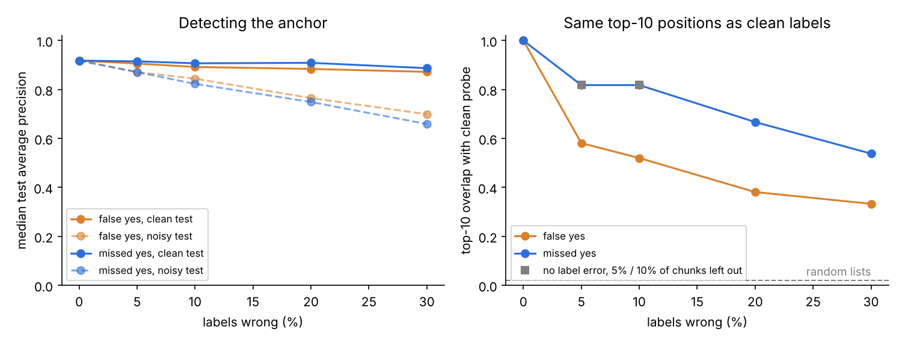

# Label noise: how careful does LLM labeling have to be?

**False "yes" labels are the dangerous error; vet the yes-labels and the
test set first.** Detection barely notices 30% label error. But just 5% of
wrong yes-labels shifts the top-10 positions far more than ordinary
sampling does. Missing a few yes-labels costs no more than having fewer
chunks.

## Setup

- Data: 2,487 Reuters articles, 40 topics, LSA stand-in embeddings
  (`build_reuters_lsa.py --per-topic 150`), fixed split.
- Two kinds of error, added to train and val labels, 0 to 30%, 3 random
  draws each:
  - *missed yes*: that share of each anchor's yes-labels flipped to no
    (LLM too strict)
  - *false yes*: no-labels flipped to yes, as many as that share of the
    anchor's real yes-labels (LLM too loose)
- Scored on clean test labels (what the probe really learned) and on test
  labels with the same noise (what we'd measure without vetting the test
  set). Positions: overlap of each anchor's top 10 with the clean probe's.
- Reference: clean labels, with 5% or 10% of training chunks left out.
- Run: `python -m experiments.label_noise` (about 40 seconds).

## Results (`label_noise.csv`)

| Labels wrong | Avg. precision, clean test | Avg. precision, noisy test | Top-10 overlap with clean |
|---|---|---|---|
| none | 0.92 | 0.92 | 1.00 |
| 5% missed yes | 0.92 | 0.87 | 0.82 |
| 10% missed yes | 0.91 | 0.82 | 0.82 |
| 20% missed yes | 0.91 | 0.75 | 0.67 |
| 5% false yes | 0.91 | 0.87 | 0.58 |
| 10% false yes | 0.89 | 0.84 | 0.52 |
| 20% false yes | 0.88 | 0.77 | 0.38 |
| reference: 5-10% of chunks left out, no error | 0.92 | | 0.82 |

## What this means for us

1. **Tell the labeling LLM to be strict.** When unsure, "no" is the safer
   mistake: 10% missed yes moves positions no more than losing 10% of the
   chunks, while 5% false yes already drops the overlap to 0.58.
2. **Vet every yes-label.** There are about 75 per anchor, far fewer than
   the no-labels, so checking all of them by hand (or with a second LLM)
   is feasible and covers the error that hurts positions most.
3. **Vet the test set completely.** An unchecked test set makes the probe
   look worse than it is (0.75 instead of 0.91 at 20% error), and the
   bag-of-words comparison would be measured against the same bad labels.
4. Hard negatives matter here: a chunk that is almost, but not quite, an
   anchor is exactly where an LLM gives a false yes.

Caveat: LSA stand-in embeddings and random errors. Real LLM mistakes are
not random; they cluster on borderline chunks, which may hurt more.
