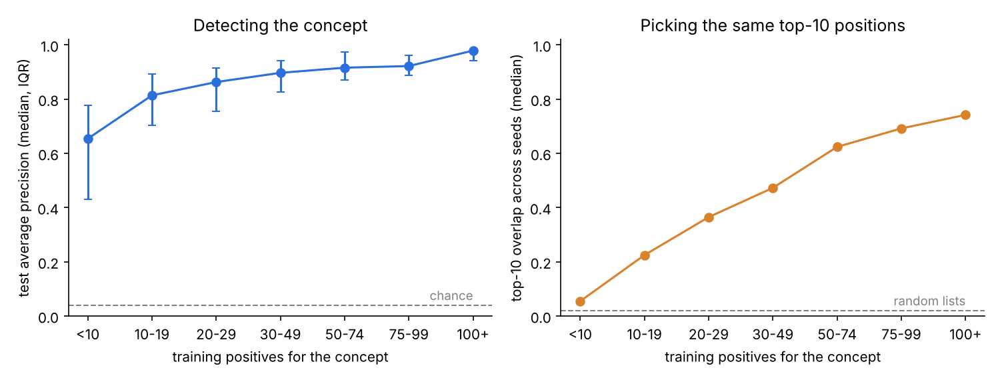

# Sample size: how many labeled chunks per concept?

**Aim for at least 50 training positives per concept, about 75 labeled
chunks per concept once val and test are split off.** The probe can
*detect* a concept with ~20 examples, but the *positions* it picks only
become repeatable at around 50.

## Setup

- Data: 2,487 Reuters articles, same 40 topics as the real-text check, LSA
  stand-in embeddings (`build_reuters_lsa.py --per-topic 150`).
- Test set fixed (493 chunks). The probe is trained on 10% to 80% of the
  training set, 3 random samples each. Each point = one concept in one run,
  binned by how many training positives that concept had.
- Stability = overlap (Jaccard) of the top-10 positions picked by the 3
  runs. Random lists would overlap 0.02.
- Run: `python -m experiments.sample_size` (about 30 seconds).

## Results (`sample_size.csv`)

| Training positives | Median test avg. precision | Top-10 overlap across runs |
|---|---|---|
| under 10 | 0.65 | 0.06 |
| 10 to 19 | 0.81 | 0.23 |
| 20 to 29 | 0.86 | 0.37 |
| 30 to 49 | 0.90 | 0.47 |
| 50 to 74 | 0.92 | 0.62 |
| 75 to 99 | 0.92 | 0.69 |
| 100+ (12 points only) | 0.98 | 0.74 |

## What this means for us

1. Detection plateaus around 30 to 50 positives; positions keep improving
   past 75. Since positions are the point of the project, they set the
   number we need.
2. With a 70/10/20 split, 50 training positives = about 75 labeled chunks
   per concept. Our plan (40 concepts in 1,000 chunks) gives about 25 per
   concept if each chunk has one label. That works only if chunks carry
   several labels each, or we cut to ~15 concepts, or label more chunks.
3. Topics with fewer than ~15 chunks in the whole dataset (most of the
   current least-frequent Reuters list) cannot give stable positions.

Caveat: LSA stand-in embeddings. Rerun on the real model's embeddings once
we have them; the shape should hold, the exact numbers may shift.
